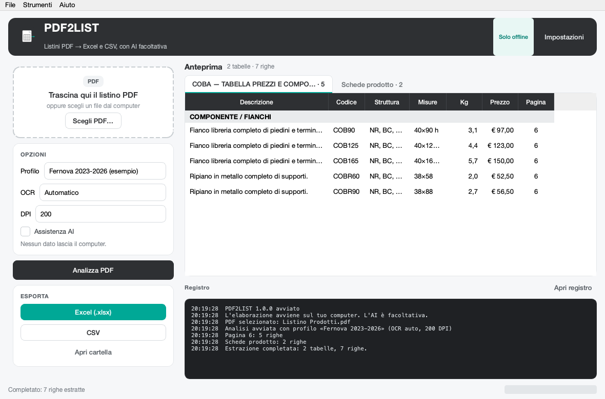

# PDF2LIST

**Trasforma i listini PDF in Excel e CSV.** App desktop per macOS (Intel e Apple Silicon) e Windows, con OCR offline e assistenza AI facoltativa.

PDF2LIST nasce dal procedimento usato per convertire il listino Fernova 2023/2026: lettura delle parole con le loro coordinate, ricostruzione della griglia di colonne, estrazione delle righe, pulizia e formattazione in Excel/CSV. Quel procedimento è stato generalizzato in un'app che può essere usata con altri listini.



## Funzioni

- PDF con testo **e** PDF scansionati (immagini) tramite OCR integrato.
- Riconoscimento automatico delle tabelle prezzi e delle schede prodotto.
- Colonne riconosciute in italiano, inglese, tedesco, francese e spagnolo.
- Profili di estrazione riutilizzabili (sinonimi, correzioni OCR, override).
- Excel impaginato come database: un unico foglio **Listino**, intestazioni, filtri, colonne congelate, formati valuta/peso, gruppo, pagina.
- CSV compatibile con Excel italiano (`;`, decimali con virgola, UTF-8 con BOM).
- AI **facoltativa** per mappare le colonne, correggere gli spazi dell'OCR e leggere con AI Vision le pagine più difficili.
- Chiavi API nel portachiavi di sistema (Keychain / Credential Manager), mai in chiaro nel file delle impostazioni.
- Interfaccia drag & drop, anteprima dei dati, registro ed export in un clic.

## Requisiti

- macOS 11 o successivo, Intel o Apple Silicon
- Windows 10/11 a 64 bit
- In alternativa: Python 3.10–3.12 per l'avvio da sorgente

## Installazione

### macOS

1. Scarica `PDF2LIST-macOS-intel.zip` o `PDF2LIST-macOS-apple-silicon.zip` dalla pagina [Releases](https://github.com/alepifani-admin/pdf2list/releases/latest).
2. Scompatta e trascina `PDF2LIST.app` in **Applicazioni**.
3. Al primo avvio fai **clic destro → Apri** (l'app non è notarizzata con un certificato Apple). Se macOS blocca l'apertura, usa *Impostazioni di Sistema → Privacy e sicurezza → Apri comunque*.

### Windows

1. Scarica `PDF2LIST-Windows-x64.zip`.
2. Scompatta in una cartella (es. `C:\Programmi\PDF2LIST`).
3. Avvia `PDF2LIST.exe`. Se SmartScreen avvisa, scegli **Ulteriori informazioni → Esegui comunque**.

L'app non richiede installazione e non invia nulla in rete, salvo l'AI se la attivi.

## Uso

1. Trascina un PDF nella finestra (o **Scegli PDF**).
2. Controlla il profilo, la modalità OCR e i DPI.
3. Premi **Analizza PDF**.
4. Controlla l'anteprima; poi **Excel (.xlsx)** o **CSV**.

Suggerimenti:

- **Automatico** (predefinito) riconosce il formato di ogni listino: intestazioni di colonna, tabelle bordate, righe prodotto (codice + descrizione + prezzi) o schede con codice e prezzo separati. Il formato rilevato è riportato nel log e nelle proprietà del file Excel.
- **Automatico** per l'OCR usa l'OCR solo se il PDF non contiene testo. Per scansioni di bassa qualità prova **Sempre** + 300 DPI.
- Il profilo **Generico** va bene per la maggior parte dei listini e applica anch'esso il riconoscimento adattivo. Il profilo **Fernova 2023-2026** è un esempio di personalizzazione (sinonimi “Modello”, “Comp.”, correzioni OCR, override descrizioni).
- Le pagine con layout a schede (foto + tabella chiave/valore) vengono lette come **Schede prodotto**; verifica sempre titoli e descrizioni, che dipendono dalla qualità dell'OCR.
- I prezzi vengono convertiti in numeri e formattati; il CSV usa la virgola decimale per impostazione predefinita.

## Come funziona

Il motore è indipendente dalla sorgente del testo:

1. **Testo**: PyMuPDF estrae le parole con le coordinate. Se la pagina non ha uno strato di testo, viene renderizzata e passata a **RapidOCR** (ONNX, offline, CPU).
2. **Intestazioni**: individua la riga di intestazione (barra scura, sinonimi noti, densità di valori numerici sotto), unisce intestazioni su più righe e rimuove i gruppi tipo “CODICE”.
3. **Colonne**: ricostruisce i confini usando le posizioni delle intestazioni e i corridoi vuoti tra le colonne nei dati reali.
4. **Righe**: usa le colonne che hanno un valore per riga (prezzo, codice, peso) come ancore verticali; le celle multiriga vengono ricomposte.
5. **Griglia**: le tabelle larghe diventano fogli; le schede chiave/valore diventano righe prodotto; le tabelle con la stessa struttura e lo stesso prodotto vengono unite tra pagine.
6. **Formati dinamici**: se le intestazioni non bastano, il motore prova righe prodotto, schede codice/prezzo e tabelle bordate con intestazione ripetuta, poi sceglie il risultato migliore.
7. **Export**: Excel/CSV con pulizia dei refusi, numeri, pagine e metadati.

I file del progetto originale (`parse.py`, `excel.py`, `ocr.swift`) restano nella cartella come riferimento del procedimento da cui è nata l'app. Per la pubblicazione su GitHub, il listino di esempio e questi file specifici sono esclusi dal repository (vedi `PUBLISH.md`).

## Profili

Un profilo è un file JSON con:

```json
{
  "id": "mio-listino",
  "name": "Mio listino",
  "aliases": { "codice ns": "Codice", "prezzo ns": "Prezzo" },
  "text_fixes": [["\\bmonbe\\b", "gambe"], ["\\s{2,}", " "]],
  "group_patterns": ["^COMPONENTE"],
  "badge_patterns": ["visualizz"],
  "ignore_patterns": ["^pag\\."],
  "description_overrides": { "CODICE": "Descrizione corretta" },
  "product_code_overrides": { "PRODOTTO|CODICE": "Descrizione corretta" },
  "section_fixes": { "APPENDIABIII": "APPENDIABITI" }
}
```

I profili inclusi sono in `pdf2list/resources/profiles/`. Da **Impostazioni → Generale** puoi scegliere un profilo personalizzato JSON. Il profilo **Automatico** abilita il riconoscimento adattivo del formato; **Generico** usa gli stessi sinonimi multilingua e applica anch'esso il riconoscimento adattivo. Il profilo Fernova è generato dai dizionari e dalle correzioni degli script originali.

## AI facoltativa

L'app funziona completamente offline. L'AI si attiva in **Impostazioni → AI** e richiede una chiave API del provider scelto.

Provider preconfigurati: OpenAI, Anthropic, Google Gemini, Mistral, OpenRouter, DeepSeek, Ollama e LM Studio locali, più un provider compatibile OpenAI personalizzato.

Attività disponibili:

- **Mappatura intestazioni**: allinea colonne non standard ai campi `Descrizione`, `Codice`, `Prezzo`, `Misure`, ecc.
- **Correzione OCR**: inserisce gli spazi mancanti e corregge lettere/accenti. I numeri e i codici non vengono modificati se il valore numerico cambia.
- **AI Vision**: per le pagine in cui l'OCR non trova tabelle, invia l'immagine della pagina a un modello vision e ne trascrive la tabella (massimo 20 pagine per elaborazione).

Privacy e sicurezza:

- Le chiavi sono lette prima dalle variabili d'ambiente (`OPENAI_API_KEY`, `ANTHROPIC_API_KEY`, `GEMINI_API_KEY`, `MISTRAL_API_KEY`, `OPENROUTER_API_KEY`, `DEEPSEEK_API_KEY`, `PDF2LIST_API_KEY`), poi dal portachiavi di sistema.
- Con l'AI attiva vengono inviati solo i **testi estratti** (o l'immagine della pagina se usi AI Vision), non il PDF completo.
- L'AI può sbagliare: i prezzi vengono confrontati numericamente prima di accettare una correzione, ma la verifica finale è sempre consigliata.

## Uso da riga di comando

Utile per elaborare più file o automatizzare:

```bash
python -m pdf2list listino.pdf
python -m pdf2list --pdf listino.pdf --xlsx output.xlsx --csv output.csv \
  --ocr always --dpi 300 --profile fernova --pages 3-20
```

Opzioni principali: `--ocr auto|always|never`, `--dpi`, `--profile`,
`--profile-file`, `--pages`, `--password`, `--ai`, `--no-ai`, `--quiet`.

Il pacchetto macOS include anche il comando CLI:

```bash
/Applications/PDF2LIST.app/Contents/MacOS/PDF2LIST --pdf listino.pdf
```

## Output

Excel:

- un unico foglio **Listino**, pensato come tabella di database: una riga per articolo o configurazione e una colonna per campo;
- colonne stabili: `Tipo` (Articolo/Configurazione), `Tabella`, `Gruppo`, `Prodotto`, `Descrizione`, `Codice`, `Prezzo`, eventuali colonne aggiuntive (`Prezzo 2`, `Kg`, `L`, `H`, …), `Note`, `Pagina`;
- intestazione bloccata, filtro e tabella Excel `ListinoDB` già pronti per ordinare e filtrare;
- metadati (file di origine, pagine, profilo, formato, OCR, avvisi) nelle proprietà del file, senza fogli aggiuntivi.

CSV:

- un file unico con le stesse colonne del foglio Excel;
- le configurazioni dai badge sono incluse come righe con `Tipo = Configurazione`;
- un secondo file `… - CONFIGURAZIONI.csv` resta disponibile come riepilogo separato;
- separatore e decimali configurabili;
- codifica UTF-8 con BOM per l'apertura diretta in Excel.

## Avvio da sorgente

```bash
python3.11 -m venv .venv-app
.venv-app/bin/python -m pip install -r requirements.txt
.venv-app/bin/python -m pdf2list
```

Su macOS puoi anche fare doppio clic su `run.command`; su Windows usa `run.bat`.

Test:

```bash
.venv-app/bin/python -m pytest -q
```

## Build

La build non è cross-platform: ogni sistema produce il proprio pacchetto.

macOS (sulla macchina dell'architettura desiderata):

```bash
bash packaging/build_macos.sh
```

Crea `release/PDF2LIST-macOS-<arch>.zip` e `.dmg`.

Windows:

```powershell
powershell -ExecutionPolicy Bypass -File packaging\build_windows.ps1
```

Crea `release/PDF2LIST-Windows-x64.zip`.

Il workflow `.github/workflows/build.yml` compila automaticamente Intel Mac, Apple Silicon e Windows e allega gli ZIP alle release quando viene creato un tag `v*`. Per pubblicare il repository e avviare le tre build:

```bash
./packaging/publish_github.sh pdf2list --public
```

Dettagli in `PUBLISH.md`.

## Struttura del progetto

```
pdf2list/
  core/        # PDF, OCR, layout, profili, AI, export, impostazioni
  ui/          # finestra principale, impostazioni, tema
  resources/   # profili e icone
packaging/     # spec PyInstaller e script di build
tests/         # test unitari
parse.py, excel.py, ocr.swift  # procedimento originale (riferimento)
source.pdf     # listino di esempio Fernova
```

## Limiti e consigli

- La qualità dell'OCR dipende dalla scansione: 200 DPI bastano per la maggior parte dei listini, 300 DPI aiutano con caratteri piccoli.
- Testi ruotati o molto stilizzati possono perdere gli spazi: usa la correzione OCR con AI oppure verifica manualmente.
- L'app riconosce tabelle e schede chiave/valore; layout liberi o pagine di solo testo possono essere ignorati.
- I profili sono lo strumento migliore per listini ricorrenti: aggiungi sinonimi e correzioni una volta sola.
- Verifica sempre prezzi, codici, unità di misura e IVA prima di usare i dati commercialmente.

## Risoluzione problemi

| Problema | Soluzione |
|---|---|
| “Nessuna tabella riconosciuta” | Prova OCR **Sempre** e 300 DPI; seleziona il profilo giusto; attiva AI Vision. |
| OCR molto lento | Usa 150/200 DPI; l'OCR gira su CPU ed è normale che richieda qualche secondo per pagina. |
| macOS non apre l'app | Clic destro → Apri, oppure Privacy e sicurezza → Apri comunque. |
| Windows/Defender blocca l'exe | Scompatta lo ZIP e consenti l'eseguibile; la build non è firmata digitalmente. |
| La chiave API non viene salvata | Verifica il portachiavi di sistema; in alternativa usa una variabile d'ambiente. |
| Colonne unite/sbagliate | Crea un profilo con i sinonimi corretti o abilita la mappatura AI; controlla l'anteprima. |

## Licenza

MIT per il codice di PDF2LIST. Vedi `LICENSE`.

I componenti di terze parti hanno licenze proprie: in particolare PyMuPDF è
AGPL-3.0 (o licenza commerciale Artifex) e PySide6/Qt è LGPL-3.0. Leggi
`THIRD_PARTY.md` prima di distribuire l'app come prodotto commerciale chiuso.
